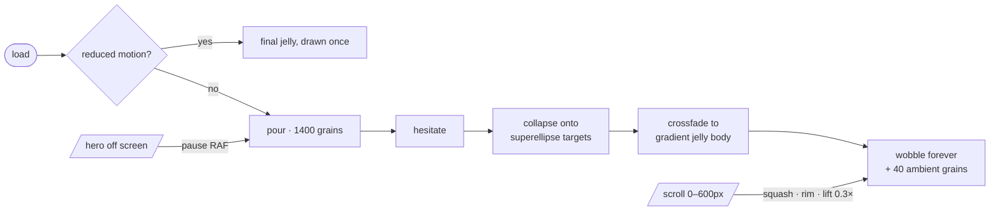
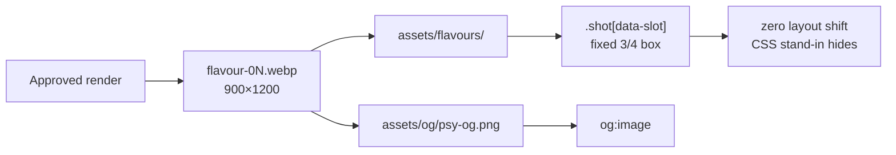

<div align="center">

# PSY.

**Daily Fibre. A New Form.**

A ready-to-eat psyllium fibre jelly in a single stick. This is the pre-launch site for India: one HTML file, one token sheet, and a canvas hero that pours loose grains into a living jelly.

[**Live site →**](https://sanskaari69.github.io/psy-fibre/) &nbsp;·&nbsp; [Design system](design/DESIGN_SYSTEM.md) &nbsp;·&nbsp; [Motion](design/motion.md) &nbsp;·&nbsp; [Architecture](docs/ARCHITECTURE.md) &nbsp;·&nbsp; [Claims rulebook](docs/COMPLIANCE.md)

<!-- SCROLL-DEMO -->

</div>

---

## Architecture

### Page structure: grounds and reveal triggers

```mermaid
flowchart LR
  classDef plum fill:#100B1D,stroke:#C9A3FF,color:#F6F3FA
  classDef rise fill:#19102B,stroke:#C9A3FF,color:#F6F3FA
  classDef purple fill:#281238,stroke:#9B4DFF,color:#F6F3FA
  H["Hero<br/>static HTML + canvas"]:::plum --> M["Marquee<br/>scroll-velocity"]:::purple --> P["Problem<br/>.r reveal"]:::plum --> F["Format<br/>.r reveal"]:::rise --> C["Landscape chart<br/>.r reveal"]:::plum --> FL["Flavours<br/>drop zones"]:::plum --> U["How to<br/>.r reveal"]:::rise --> S["Spec sheet<br/>type-in rows"]:::plum --> K["Packs"]:::purple --> W["Waitlist<br/>local only"]:::plum
```



### Animation pipeline: Format Reveal



### Asset drop flow



Deeper diagrams and the failure-mode table: [`docs/ARCHITECTURE.md`](docs/ARCHITECTURE.md).

---

## Design system

| | |
|---|---|
| **Ground** | `--plum #100B1D` · `--plum-rise #19102B` · `--purple #281238` |
| **Light** | `--violet #9B4DFF`, rim light and accents only · `--rim #C9A3FF` hairlines |
| **Type** | `--paper #F6F3FA` · `--mute #9A8FAE` |
| **Faces** | Bodoni Moda (display) · Hanken Grotesk (body) · IBM Plex Mono (utility) |
| **Scale** | 13 / 15 / 17 / 22 / 30 / 44 / 68 / 104, fluid |
| **Surfaces** | Matte. 1px hairlines, ground shifts, 2px panel radius, 999px pills |
| **Motion** | `cubic-bezier(.16,1,.3,1)` for everything that arrives |

The rule that holds it together: violet is light hitting an edge, never paint.

---

## Run it

No build step.

```bash
git clone https://github.com/Sanskaari69/psy-fibre.git
cd psy-fibre
python3 -m http.server 5190
# open http://localhost:5190
```

Every push to `main` deploys to GitHub Pages through [`.github/workflows/deploy.yml`](.github/workflows/deploy.yml). The workflow first runs a **claims gate** that fails the deploy if the page contains any banned format word.

## Structure

```
psy-fibre/
├── index.html            single-file site · inline CSS + JS · imports design/tokens.css
├── design/
│   ├── tokens.css        colour, type, space, motion: the only place values live
│   ├── DESIGN_SYSTEM.md
│   └── motion.md         every animation with its duration and curve
├── docs/
│   ├── ARCHITECTURE.md   mermaid: page, animation pipeline, asset flow
│   ├── CONTENT.md        every string on the site, for copy review
│   └── COMPLIANCE.md     what may and may not be said
├── assets/
│   ├── flavours/         pack renders drop here
│   ├── og/               share cards, scroll demo
│   └── favicon/
└── .github/workflows/deploy.yml
```

## Engineering notes

- **Readable before script.** Headline, copy and CTAs are plain HTML at full opacity. Reveal pre-states apply only under `html.anim`, which JS adds at boot, and a 4s failsafe reveals everything.
- **Canvas 2D, vanilla JS.** DPR capped at 2. The RAF loop stops when the hero leaves the viewport. State is stored in normalised units, so a resize never restarts the animation.
- **Zero layout shift** on asset swap: every drop zone is a fixed `aspect-ratio: 3/4` box.
- **`prefers-reduced-motion`**: final frame only, no wobble, no parallax, static marquee.

<!-- PLACEHOLDERS -->

---

<sub>Code: MIT. The PSY. name, wordmark and brand assets are not licensed for reuse. PSY. is a food product, not a medicine.</sub>
