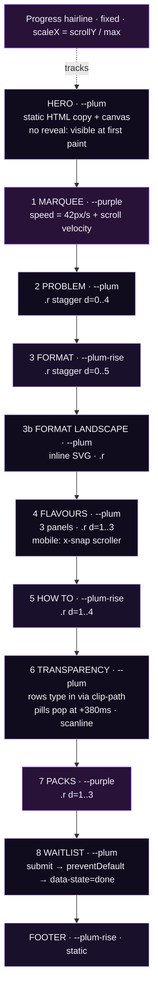
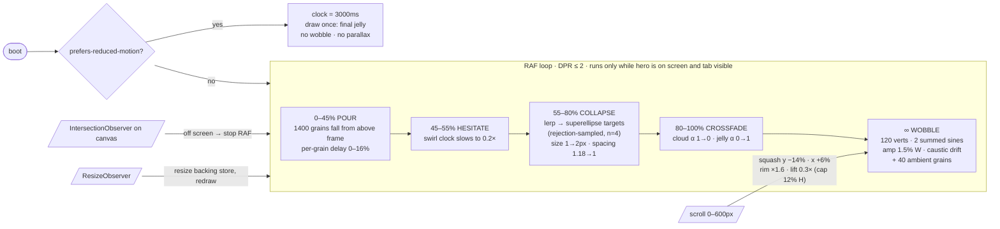
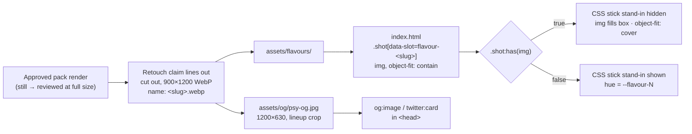

# Architecture

PSY. is one static HTML file plus one stylesheet of tokens. No build step and no framework. Every moving part is described below as a mechanism, so the next person can change it without reading all of `index.html`.

## 1 · Page structure (v1: superseded by the seven-scene v2 in the README)

Each band is a full-bleed ground colour with a 1120px inner wrapper. Reveals fire from one shared `IntersectionObserver` (`rootMargin: 0 0 -12% 0`, threshold `0.15`). Nothing in the first viewport is a `.r`, so the first frame is complete before any script runs.

## 2 · Animation pipeline: Format Reveal

One `requestAnimationFrame` loop drives one canvas. `clock` only advances while the loop runs, so pausing off-screen never skips the reveal. Particles, targets and silhouette vertices are stored in normalised units, so a resize rescales the scene and keeps its place in the timeline.

Easing throughout is `cubic-bezier(.16,1,.3,1)`, solved in JS by Newton iteration so canvas and CSS share one curve.

## 3 · Asset flow: pack renders

Renders are live (founder renders, claim lines retouched out). Each flavour panel holds a fixed `aspect-ratio: 3/4` drop zone, so the swap cannot shift layout.

## Failure modes designed against

| Failure | Guard |
|---|---|
| JS fails, or a thumbnail capture runs before scripts | `.r` is visible by default; the hidden pre-state applies only under `html.anim`. A no-JS CSS lozenge sits behind the canvas. |
| An IntersectionObserver never fires | A 4s timeout adds `.in` to every `.r`. |
| Canvas blurs or goes blank after DPR/zoom change | `ResizeObserver` rebuilds the backing store at `min(2, DPR)` and redraws. |
| Hero burns battery off screen | RAF stops when the canvas leaves the viewport or the tab hides. |
| `tokens.css` 404 on GitHub Pages subpath | Relative path `design/tokens.css`, no leading slash. |
